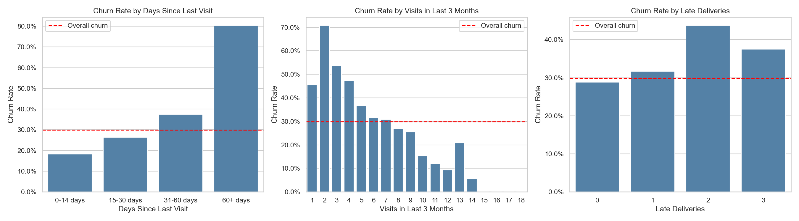
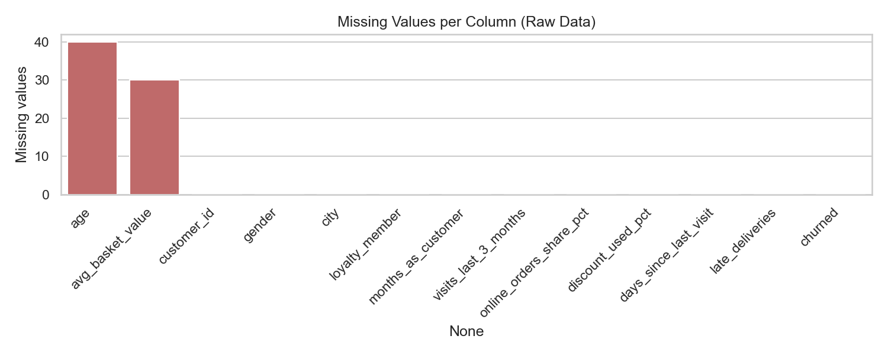
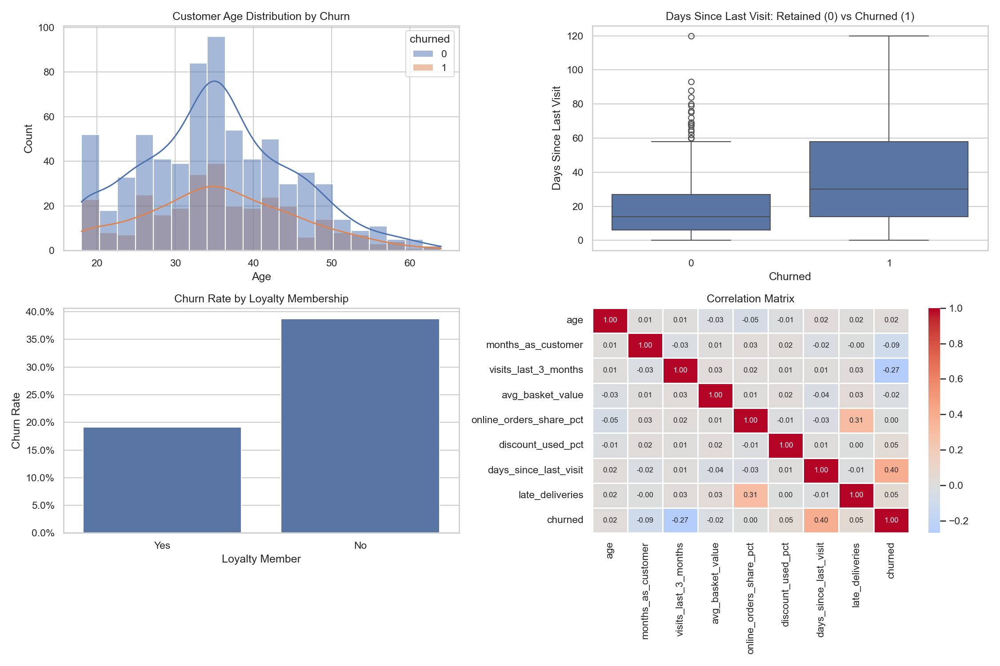

# Retail Customer Churn: Data Cleaning & Exploratory Analysis

An end-to-end data cleaning and exploratory data analysis (EDA) project on 1,000 retail customers from four cities in Uzbekistan. The goal is to understand **which customers stop shopping (churn) and why**, and to produce a clean, model-ready dataset.



## Key Findings

| Finding | Evidence |
|---|---|
| **Recency is the strongest churn signal** | Churn rises from 18% (visited in last 14 days) to **80%** (60+ days since last visit). Correlation with churn: +0.40 |
| **Visit frequency protects against churn** | Customers with ≤4 visits in 3 months churn at 45–70%; with 10+ visits, below 20%. Correlation: −0.27 |
| **Loyalty programme halves churn** | Members churn at **19%** vs **39%** for non-members |
| **Late deliveries hurt** | Churn goes from 29% (no late deliveries) to 44% (2 late deliveries) |
| Demographics barely matter | Gender (29% vs 30%) and age groups (27–31%) show almost no difference |

**Business takeaway:** a "win-back" campaign targeted at non-loyalty customers who haven't visited in 30+ days would reach the highest-risk segment. Enrolling customers in the loyalty programme and reducing delivery delays are the next levers.

## Data Cleaning Steps

| Step | What was done | Result |
|---|---|---|
| Duplicates | Checked full-row and `customer_id` duplicates | None found |
| Categorical consistency | Trimmed whitespace and standardized casing | `gender`, `city`, `loyalty_member` consistent |
| Invalid values | Range checks (e.g. age 16–100, percentages 0–100, no negative counts) | No invalid values |
| Missing values | Median imputation (robust to skew) | `age`: 40 filled, `avg_basket_value`: 30 filled |
| Outliers | IQR rule, then checked the churn rate inside each outlier group | **Kept**, see below |
| Encoding | Binary encoding for `loyalty_member`, one-hot for `gender` and `city` | Model-ready CSV in `data/processed/` |

### Why outliers were kept

Blindly removing IQR outliers is a common mistake. The 46 outliers in `days_since_last_visit` have an **89% churn rate** (vs 30% overall). They are real, plausible customers and the clearest churn signal in the data. Removing them would bias any churn analysis or model. Columns where IQR = 0 (e.g. `late_deliveries`, mostly zeros) were skipped, because the IQR rule would flag every non-zero value.



## Exploratory Overview



## Dataset

`data/shop_customers.csv`: 1,000 rows, 13 columns.

| Column | Description |
|---|---|
| `customer_id` | Unique customer identifier |
| `age`, `gender`, `city` | Demographics |
| `loyalty_member` | Member of the loyalty programme (Yes/No) |
| `months_as_customer` | Customer tenure |
| `visits_last_3_months` | Number of store visits in the last 3 months |
| `avg_basket_value` | Average purchase value |
| `online_orders_share_pct` | Share of orders placed online (%) |
| `discount_used_pct` | Share of purchases using a discount (%) |
| `days_since_last_visit` | Days since the most recent visit |
| `late_deliveries` | Number of late deliveries experienced |
| `churned` | Target: 1 if the customer churned |

## Project Structure

```
├── data/
│   ├── shop_customers.csv              # raw data
│   └── processed/
│       └── shop_customers_clean.csv    # cleaned, encoded, model-ready
├── figures/                            # charts generated by main.py
├── main.py                             # cleaning + analysis pipeline
└── requirements.txt
```

## How to Run

```bash
python3 -m venv .venv
source .venv/bin/activate        # Windows: .venv\Scripts\activate
pip install -r requirements.txt
python main.py
```

The script prints each cleaning and analysis step to the console, saves the charts to `figures/`, and writes the model-ready dataset to `data/processed/`.

## Tools

Python · pandas · matplotlib · seaborn

## Next Steps

- Train a churn classifier (logistic regression / gradient boosting) on the processed dataset
- Test whether the loyalty-programme effect holds after controlling for visit frequency
